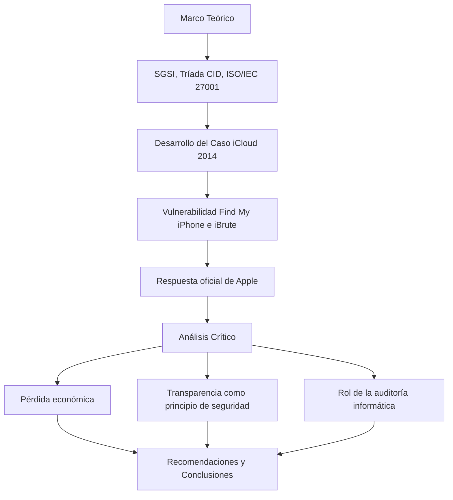

<div align="center">

# 🔐 Auditoría Informática: Caso Celebgate (iCloud 2014)

### *Análisis Crítico del Robo de Datos en iCloud desde la Perspectiva de la Auditoría de Sistemas de Información*

[]()
[](https://www.unir.net/)
[]()
[]()

**[Descripción](#-descripción-del-proyecto) • [Temas Abordados](#-temas-abordados) • [Arquitectura del Análisis](#-arquitectura-del-análisis) • [Contenido](#-contenido-del-repositorio) • [Metodología](#-metodología-aplicada) • [Autor](#-autor)**


</div>

---

## 📋 Tabla de Contenidos

- [🎯 Descripción del Proyecto](#-descripción-del-proyecto)
- [✨ Ejes del Análisis](#-ejes-del-análisis)
- [🧭 Temas Abordados](#-temas-abordados)
- [🏗️ Arquitectura del Análisis](#-arquitectura-del-análisis)
- [📁 Contenido del Repositorio](#-contenido-del-repositorio)
- [🔎 Metodología Aplicada](#-metodología-aplicada)
- [📂 Estructura del Proyecto](#-estructura-del-proyecto)
- [👨‍💻 Autor](#-autor)

---

## 🎯 Descripción del Proyecto

Este repositorio contiene el desarrollo del **Laboratorio #1: Importancia de la Auditoría Informática**, elaborado para la asignatura **Calidad y Auditoría de Sistemas de Información** de la Fundación Universitaria Internacional de La Rioja (UNIR). El trabajo realiza un **análisis crítico del incidente de seguridad de iCloud ocurrido en 2014**, conocido públicamente como *"Celebgate"*, en el que cientos de cuentas de celebridades fueron comprometidas mediante ataques de fuerza bruta contra el servicio *Find My iPhone*.

### 🌟 ¿Por qué este análisis es relevante?

- 🔍 **Estudio de caso real**: analiza un incidente documentado con impacto mediático, legal y económico verificable.
- 🛡️ **Enfoque desde la auditoría**: no se limita a describir el ataque, sino que evalúa qué controles de auditoría informática habrían podido prevenirlo o mitigarlo.
- 📜 **Base normativa sólida**: contrasta el caso contra el estándar ISO/IEC 27001:2022 y su Anexo A.
- ⚖️ **Perspectiva legal**: incorpora el marco regulatorio de protección de datos aplicable (RGPD, LOPD, LSSICE, Ley 1581 de 2012).
- 🧩 **Análisis crítico propio**: evalúa la pérdida económica, la transparencia de Apple ante el incidente y el rol preventivo que debió tener la auditoría.

---

## ✨ Ejes del Análisis

<table align="center" width="100%">
  <tr>
    <td width="50%" valign="top">

<h3>📚 Marco Teórico</h3>

<ul>
  <li>✅ Sistema de Gestión de Seguridad de la Información (SGSI)</li>
  <li>✅ Tríada CID (Confidencialidad, Integridad, Disponibilidad)</li>
  <li>✅ Gestión de activos, amenazas, vulnerabilidades y riesgos</li>
  <li>✅ Estructura de la norma ISO/IEC 27001:2022</li>
  <li>✅ Tipos y funciones de la auditoría informática</li>
</ul>

<h3>🧪 Análisis Crítico</h3>

<ul>
  <li>📊 Reconstrucción cronológica del caso Celebgate</li>
  <li>📊 Vulnerabilidad explotada (Find My iPhone / iBrute)</li>
  <li>📊 Evaluación de la respuesta oficial de Apple</li>
  <li>📊 Impacto económico y reputacional del incidente</li>
  <li>📊 Recomendaciones desde la auditoría preventiva</li>
</ul>

  </tr>
</table>

---

## 🧭 Temas Abordados

<div align="center">

| 📚 **Marco Teórico y Normativo** | 🕵️ **Desarrollo del Caso** | ⚖️ **Análisis Crítico** |
|:----------------------------------:|:-----------------------------:|:---------------------------:|
| SGSI, tríada CID, no repudio | Vulnerabilidad Find My iPhone / iBrute | Pérdida económica del incidente |
| ISO/IEC 27001:2022 y Anexo A | Respuesta oficial de Apple | Transparencia como principio de seguridad |
| Auditoría vs. consultoría vs. asesoría | Marco legal (RGPD, LOPD, LSSICE, Ley 1581) | Rol preventivo de la auditoría informática |

</div>

El análisis desarrolla, entre otros puntos:
- Fundamentos de la seguridad de la información (SGSI, tríada CID, no repudio).
- Gestión de activos, amenazas, vulnerabilidades y riesgos.
- Estructura de la norma ISO/IEC 27001:2022 y su Anexo A.
- Auditoría informática: tipos, funciones y diferencias con consultoría y asesoría.
- Marco legal aplicable a la protección de datos (RGPD, LOPD, LSSICE, Ley 1581 de 2012).
- Análisis crítico del caso Celebgate: impacto económico, transparencia y el rol preventivo de la auditoría.

---

## 🏗️ Arquitectura del Análisis



---

## 📁 Contenido del Repositorio

<table align="center">
  <tr>
    <th>Archivo</th>
    <th>Descripción</th>
  </tr>
  <tr>
    <td><code>Desarrollo_Proyecto_Alejandro_De_Mendoza_Tovar.pdf</code></td>
    <td>📄 Documento final con el desarrollo completo de la actividad: marco teórico, desarrollo del caso, análisis crítico, recomendaciones, glosario, conclusiones y bibliografía</td>
  </tr>
</table>

> ℹ️ El repositorio versiona **únicamente el PDF final**. Los documentos editables (`.docx`) y archivos temporales de trabajo quedan excluidos vía `.gitignore`.

---

## 🔎 Metodología Aplicada

1. 📚 Revisión del marco teórico de seguridad de la información y del estándar **ISO/IEC 27001:2022**.
2. 🕵️ Reconstrucción documentada del caso Celebgate: vector de ataque, alcance y cronología.
3. 🏢 Evaluación de la respuesta institucional de Apple ante el incidente.
4. ⚖️ Contraste del caso contra el marco legal de protección de datos vigente (RGPD, LOPD, LSSICE, Ley 1581 de 2012).
5. 🧩 Análisis crítico propio sobre el impacto económico, la transparencia y el rol que debió cumplir la auditoría informática preventiva.
6. ✅ Formulación de recomendaciones y conclusiones.

---

## 📂 Estructura del Proyecto

```
caso-celebgate-auditoria-informatica/
│
├── 📄 Desarrollo_Proyecto_Alejandro_De_Mendoza_Tovar.pdf   # Informe final
├── 📄 README.md
└── 📄 .gitignore
```

---

## 📜 Marco Normativo y Referencias

<div align="center">


</div>

---

## 👨‍💻 Autor

<div align="center">

**Alejandro De Mendoza**

Laboratorio desarrollado en el marco de la asignatura **Calidad y Auditoría de Sistemas de Información**

[](https://github.com/AlejoTechEngineer)

</div>

---

<div align="center">

### 🔐 *Auditoría informática como herramienta preventiva ante incidentes de seguridad de la información*

</div>
