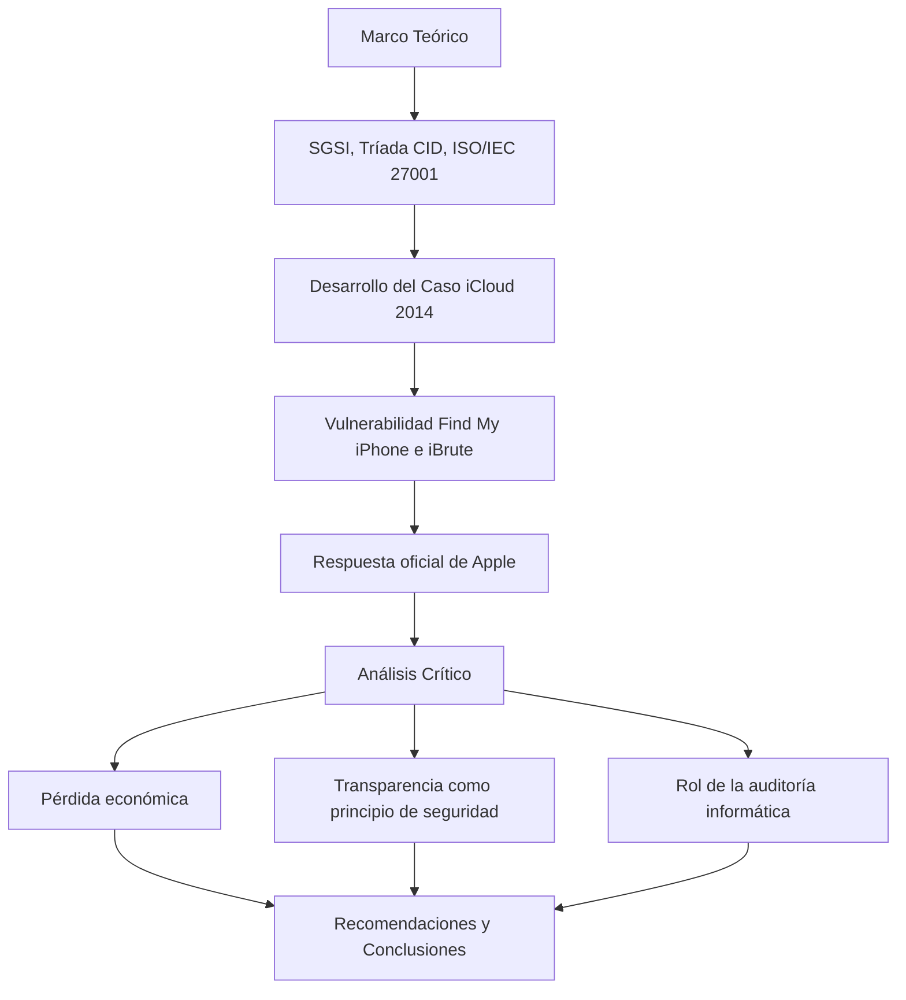

# Auditoría Informática - Análisis Crítico del Caso de Robo de Datos en iCloud (Celebgate 2014)

---

Este repositorio contiene el desarrollo del **Laboratorio #1: Importancia de la Auditoría Informática**, un análisis crítico del incidente de seguridad de iCloud ocurrido en 2014 (conocido como "Celebgate"), elaborado para la asignatura de Calidad y Auditoría de Sistemas de Información.

## Contenido del repositorio:

- `Desarrollo_Proyecto_Alejandro_De_Mendoza_Tovar.pdf` → Documento final con el desarrollo completo de la actividad: marco teórico, análisis del caso, análisis crítico, recomendaciones, glosario, conclusiones y bibliografía.

## Estructura del trabajo

## Temas abordados

El análisis desarrolla, entre otros:
- Fundamentos de la seguridad de la información (SGSI, tríada CID, no repudio).
- Gestión de activos, amenazas, vulnerabilidades y riesgos.
- Estructura de la norma ISO/IEC 27001:2022 y su Anexo A.
- Auditoría informática: tipos, funciones y diferencias con consultoría y asesoría.
- Marco legal aplicable a la protección de datos (RGPD, LOPD, LSSICE, Ley 1581 de 2012).
- Análisis crítico del caso Celebgate: impacto económico, transparencia y el rol preventivo de la auditoría.

## Autor:

Este laboratorio fue desarrollado en el marco de la asignatura **Calidad y Auditoría de Sistemas de Información**.

- ***Alejandro De Mendoza*** – [Perfil GitHub](https://github.com/AlejoTechEngineer)

---
